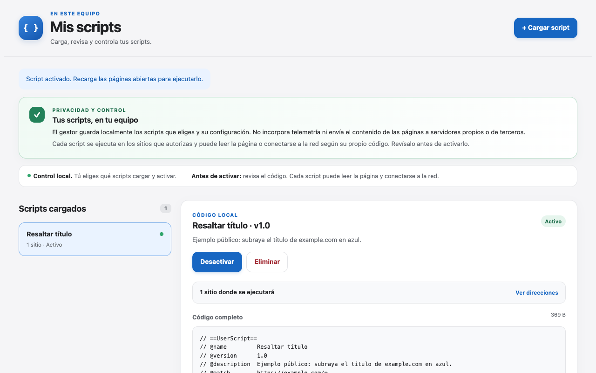

# Mis scripts locales

Gestor pequeño de userscripts para Chrome. Carga archivos `.user.js` desde tu equipo, permite revisar su código completo y solicita acceso a los sitios declarados cuando activas cada script. Los archivos quedan en `chrome.storage.local`. No hay cuentas, sincronización, telemetría ni conexiones de red automáticas hechas por el gestor.

Código abierto bajo licencia MIT. El gestor no descarga ni actualiza los scripts que importas. Las actualizaciones de la extensión, cuando se distribuya en Chrome Web Store, siguen el mecanismo habitual de Chrome.



## Instalación de prueba

1. Abre `chrome://extensions` en Chrome 138 o posterior.
2. Activa **Modo de desarrollador** y elige **Cargar descomprimida**.
3. Selecciona la carpeta del proyecto que contiene `manifest.json`.
4. En los detalles de la extensión, activa **Permitir scripts de usuario**.
5. Haz clic en el icono de la extensión para abrir el gestor.
6. Carga un archivo `.user.js`, revisa el código y activa el script. Chrome pedirá acceso a los sitios correspondientes. Recarga una página ya abierta para ejecutar el script allí.

## Alcance

- Compatible con scripts `@grant none`, `@match` de sitios HTTP(S) concretos, `@run-at` y `@noframes`.
- Se ejecutan en el contexto principal de la página mediante `chrome.userScripts`. Esto permite interactuar con el JavaScript del sitio, pero también expone el script a ese sitio.
- Directivas como `@require`, `@connect`, `@include` y APIs `GM_*` se rechazan durante la carga. El gestor no descarga dependencias ni busca actualizaciones.
- Un script cargado puede leer la página y realizar conexiones por su propia cuenta. Revisa su código antes de activarlo. La ausencia de telemetría corresponde al **gestor**, no garantiza el comportamiento de cualquier script importado.
- Los scripts registrados se restauran al actualizar la extensión. Si Chrome desactiva el permiso de scripts de usuario, abre el gestor después de volver a habilitarlo.
- La extensión no ejecuta scripts automáticamente al importarlos. Desactivarlos o eliminarlos impide su ejecución en próximas cargas de página.
- Para detener un script que ya se ejecutó en una pestaña, desactívalo y recarga esa página. Sus efectos y conexiones existentes no se revierten automáticamente.

## Verificación local

```sh
node --check comun.js
node --check fondo.js
node --check gestor.js
node --test pruebas.test.js
python3 empaquetar.py
```

El gestor es código abierto bajo la licencia MIT. Esta licencia no se aplica a los scripts que importe cada persona.

La declaración de privacidad está en [PRIVACIDAD.md](PRIVACIDAD.md). La ficha preparada para Chrome Web Store está en [PUBLICACION.md](PUBLICACION.md). El empaquetado incluye únicamente archivos explícitos de la extensión; no incluye scripts importados, capturas, pruebas ni documentación de desarrollo.

Para informar un problema funcional, abre un issue en este repositorio sin adjuntar contraseñas, código privado ni datos personales de las páginas. Para comunicar una vulnerabilidad, consulta [SEGURIDAD.md](SEGURIDAD.md).
