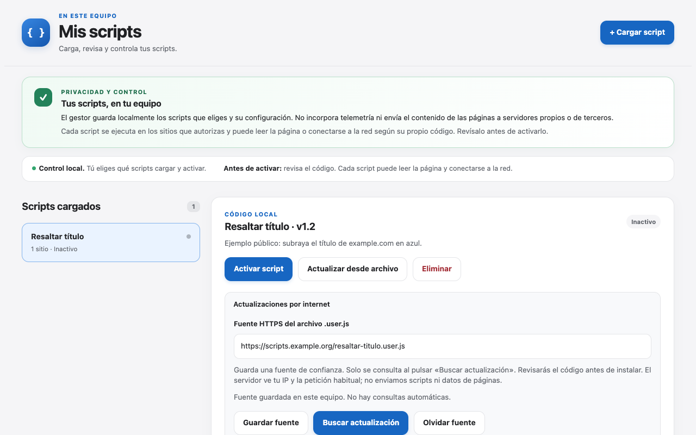

# Mis scripts locales

Gestor pequeño de userscripts para Chrome. Carga archivos `.user.js` desde tu equipo, permite revisar su código completo y solicita acceso a los sitios declarados cuando activas cada script. Los archivos quedan en `chrome.storage.local`. No hay cuentas, sincronización, telemetría ni conexiones de red automáticas hechas por el gestor. Las actualizaciones por internet se consultan únicamente al pulsar un botón y se revisan antes de instalar.

Código abierto bajo licencia MIT. El gestor permite reemplazar scripts desde archivos locales después de revisarlos; no los descarga ni actualiza automáticamente. También permite consultar una fuente HTTPS configurada explícitamente. Las actualizaciones de la extensión, cuando se distribuya en Chrome Web Store, siguen el mecanismo habitual de Chrome.



## Instalación de prueba

1. Abre `chrome://extensions` en Chrome 138 o posterior.
2. Activa **Modo de desarrollador** y elige **Cargar descomprimida**.
3. Selecciona la carpeta del proyecto que contiene `manifest.json`.
4. En los detalles de la extensión, activa **Permitir scripts de usuario**.
5. Haz clic en el icono de la extensión para abrir el gestor.
6. Carga un archivo `.user.js`, revisa el código y activa el script. Chrome pedirá acceso a los sitios correspondientes. Recarga una página ya abierta para ejecutar el script allí.

## Alcance

- Compatible con scripts `@grant none`, `@match` de sitios HTTP(S) concretos, `@run-at` y `@noframes`.
- Se ejecutan en el contexto principal de la página mediante `chrome.userScripts`. Esto permite interactuar con el JavaScript del sitio, pero también expone el script a ese sitio.
- Directivas como `@require`, `@connect`, `@include` y APIs `GM_*` se rechazan durante la carga. El gestor no descarga dependencias ni busca actualizaciones automáticamente.
- Un script cargado puede leer la página y realizar conexiones por su propia cuenta. Revisa su código antes de activarlo. La ausencia de telemetría corresponde al **gestor**, no garantiza el comportamiento de cualquier script importado.
- Los scripts registrados se restauran al actualizar la extensión. Si Chrome desactiva el permiso de scripts de usuario, abre el gestor después de volver a habilitarlo.
- La extensión no ejecuta scripts automáticamente al importarlos. Desactivarlos o eliminarlos impide su ejecución en próximas cargas de página.
- Para actualizar, selecciona el script y pulsa **Actualizar desde archivo**. Revisa el código anterior y el nuevo y confirma el reemplazo: conserva su identidad sin duplicarlo, incluso si la versión es la misma. Si cambian sus sitios o el alcance en marcos, queda inactivo hasta que vuelvas a activarlo; con el mismo alcance conserva su estado. Recarga las páginas abiertas después de actualizar.
- Al cargar un archivo con el mismo `@name` y `@namespace`, el gestor ofrece actualizar el existente o importar una copia inactiva. Si ya hay varias copias, selecciona explícitamente cuál actualizar. La comparación usa el código de los archivos previamente guardados, sin requerir una migración del almacenamiento.
- La revisión se mantiene solo en memoria mientras está abierta. Cancelarla no reemplaza el script.
- Para detener un script que ya se ejecutó en una pestaña, desactívalo y recarga esa página. Sus efectos y conexiones existentes no se revierten automáticamente.

## Verificación local

```sh
node --check comun.js
node --check fondo.js
node --check gestor.js
node --check ota.js
node --test pruebas.test.js ota.test.js
python3 empaquetar.py
```

El gestor es código abierto bajo la licencia MIT. Esta licencia no se aplica a los scripts que importe cada persona.

La declaración de privacidad está en [PRIVACIDAD.md](PRIVACIDAD.md). La ficha preparada para Chrome Web Store está en [PUBLICACION.md](PUBLICACION.md). El empaquetado incluye únicamente archivos explícitos de la extensión; no incluye scripts importados, capturas, pruebas ni documentación de desarrollo.

Para informar un problema funcional, abre un issue en este repositorio sin adjuntar contraseñas, código privado ni datos personales de las páginas. Para comunicar una vulnerabilidad, consulta [SEGURIDAD.md](SEGURIDAD.md).

## Actualizaciones por internet (OTA manual, desde 0.1.6)

1. Selecciona un script y abre **Actualizaciones por internet**.
2. Revisa la fuente propuesta por `@downloadURL` o escribe la dirección HTTPS directa al archivo `.user.js` del autor. **Guardar fuente** conserva esa preferencia local, sin hacer consultas. Si solo existe `@updateURL` a un archivo de metadatos, necesitas indicar la URL del código completo; el gestor no deduce ni sigue otras direcciones.
3. Pulsa **Buscar actualización** y concede acceso al sitio de descarga. Se consulta únicamente esa URL, sin cookies, credenciales, Referer, parámetros ni cuerpo de datos. El servidor recibe tu IP y la petición habitual.
4. Si el código cambia, revisa versión, sitios y ambos códigos y confirma. Se verifica el mismo `@name` y `@namespace`; las versiones numéricas anteriores se rechazan. Una versión igual con código diferente puede revisarse y reemplazarse.
5. Cancela para conservar el original, o usa **Olvidar fuente** para quitar la configuración. No hay búsquedas periódicas ni instalaciones automáticas.

Se requieren URLs HTTPS directas, sin consultas, fragmentos, credenciales ni puertos especiales. No se siguen redirecciones ni se admite autenticación de fuentes. La descarga tiene límite de 2 MB y espera de 20 segundos. Se intenta retirar el permiso temporal sin retirar los sitios necesarios de scripts activos ni permisos anteriores. La fuente guardada no cambia por lo que declare una actualización. HTTPS y la revisión manual no certifican la seguridad del código.
